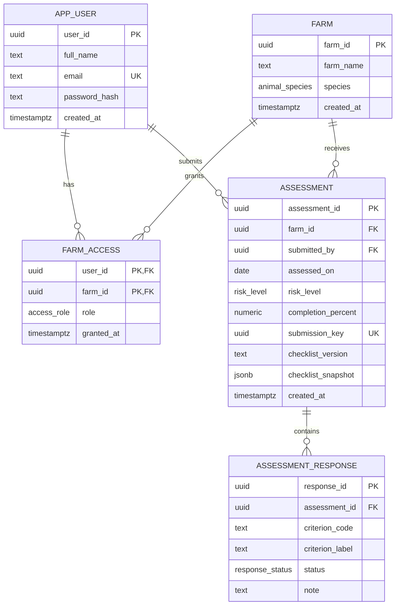

# 2. ER Diagram and Data Modelling

## Entities

### `app_user`
- `user_id` — UUID, primary key
- `full_name` — text, required
- `email` — text, required and unique
- `password_hash` — text, required
- `created_at` — timestamptz

### `farm`
- `farm_id` — UUID, primary key
- `farm_name` — text, required
- `species` — enum (`pig`, `poultry`)
- `created_at` — timestamptz

### `farm_access`
- `user_id` — UUID, foreign key to `app_user`
- `farm_id` — UUID, foreign key to `farm`
- `role` — enum (`owner`, `manager`, `veterinarian`)
- `granted_at` — timestamptz
- Composite primary key: (`user_id`, `farm_id`)

### `assessment`
- `assessment_id` — UUID, primary key
- `farm_id` — UUID, foreign key to `farm`
- `submitted_by` — UUID, foreign key to `app_user`
- `assessed_on` — date
- `risk_level` — enum (`low`, `moderate`, `high`, `critical`, `not_assessed`)
- `completion_percent` — numeric(5,2), constrained to 0–100
- `submission_key` — UUID, unique idempotency key
- `checklist_version` — text
- `checklist_snapshot` — JSONB historical snapshot
- `created_at` — timestamptz

### `assessment_response`
- `response_id` — UUID, primary key
- `assessment_id` — UUID, foreign key to `assessment`
- `criterion_code` — text, stable checklist identifier
- `criterion_label` — text, label shown at assessment time
- `status` — enum (`done`, `follow_up`, `not_applicable`)
- `note` — text, optional
- Unique constraint: (`assessment_id`, `criterion_code`)

## Relationships and cardinality

- `app_user` to `farm_access`: one-to-many.
- `farm` to `farm_access`: one-to-many.
- `app_user` to `farm`: many-to-many through `farm_access`.
- `farm` to `assessment`: one-to-many.
- `app_user` to `assessment`: one-to-many (a user may submit many assessments).
- `assessment` to `assessment_response`: one-to-many.
- A one-to-one relationship is not required by the current FarmWard requirements. No artificial one-to-one table is introduced merely to demonstrate a relationship type.

## Mermaid ER diagram

`farm_access` is the associative entity that resolves the many-to-many relationship between users and farms. A one-to-one relationship is not present in the stated business requirements.
